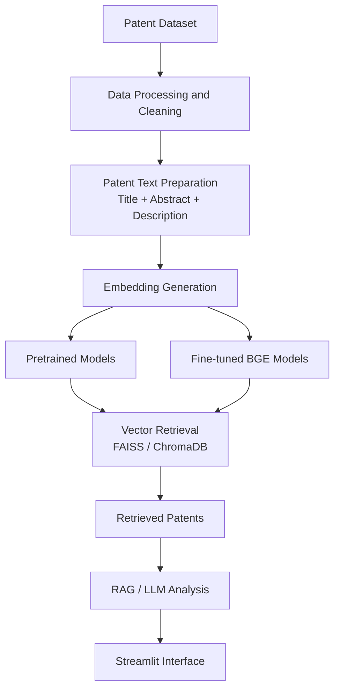

# Patent Intelligence: Semantic Search, Retrieval and RAG

An end-to-end pipeline for patent discovery and analysis, combining transformer-based embeddings, domain-specific fine-tuning, vector search, and Retrieval-Augmented Generation (RAG).

The project explores how semantic representation learning can improve patent retrieval beyond traditional keyword-based search.

## Table of Contents

- [Overview](#overview)
- [Architecture](#architecture)
- [Dataset](#dataset)
- [Embedding Models](#embedding-models)
- [Fine-tuned Models](#fine-tuned-models)
- [Retrieval and Vector Search](#retrieval-and-vector-search)
- [Benchmarking](#benchmarking)
- [RAG and Language Models](#rag-and-language-models)
- [Interactive Application](#interactive-application)
- [Technology Stack](#technology-stack)
- [Repository Structure](#repository-structure)
- [Installation](#installation)
- [Running the Benchmark](#running-the-benchmark)
- [Future Work](#future-work)
- [Authors](#authors)

## Overview

Patent documents contain specialised terminology spread across titles, abstracts, claims, and lengthy descriptions. Keyword matching alone often misses relevant patents that describe the same idea in different words.

This project provides a pipeline to:

- Process and analyse patent datasets
- Generate semantic embeddings using multiple pretrained models
- Fine-tune BGE models using weak CPC-based supervision
- Compare embedding models through retrieval benchmarks
- Perform semantic retrieval using FAISS and ChromaDB
- Explore RAG-based patent analysis and summarisation
- Provide an interactive interface through Streamlit
- Experiment with locally hosted and API-based language models

## Architecture



## Dataset

The project uses the Harvard USPTO Patent Dataset (HUPD). Dataset processing included:

- Processing 26,808 patent JSON records
- Creating a structured CSV dataset
- Extracting patent titles, abstracts, descriptions, and CPC classifications
- Analysing CPC subclass distributions
- Preparing patent text for embedding generation and retrieval experiments

Some experiments use smaller subsets to reduce computational requirements.

## Embedding Models

Multiple pretrained embedding models were evaluated for patent semantic retrieval.

| Model | Description |
|---|---|
| PatentSBERTa | Patent-domain sentence embeddings |
| PaECTER | Patent similarity and retrieval |
| BGE-base-en-v1.5 | General-purpose embedding model |
| E5-base-v2 | General-purpose text embeddings |
| all-mpnet-base-v2 | Sentence-level semantic embeddings |
| all-MiniLM-L6-v2 | Lightweight sentence embeddings |
| Nomic Embed v1.5 | General-purpose embedding model |

## Fine-tuned Models

Three BGE-based models were fine-tuned on patent data using weak supervision derived from CPC classifications. Each explores a different training objective.

| Model | Training Objective | Hugging Face |
|---|---|---|
| BGE Patent MNRL | Multiple Negatives Ranking Loss | [patzer-adi/bge-patent-mnrl](https://huggingface.co/patzer-adi/bge-patent-mnrl) |
| BGE Similarity Contrastive | Similarity-based contrastive learning | [patzer-adi/bge-patent-similarity-contrastive](https://huggingface.co/patzer-adi/bge-patent-similarity-contrastive) |
| BGE Hybrid Contrastive | Hybrid contrastive learning | [patzer-adi/bge-patent-hybrid-contrastive](https://huggingface.co/patzer-adi/bge-patent-hybrid-contrastive) |

### Usage

The models are hosted on Hugging Face. Weights are maintained separately from this repository to avoid committing large binary files.

```bash
pip install sentence-transformers
```

```python
from sentence_transformers import SentenceTransformer

model = SentenceTransformer("patzer-adi/bge-patent-mnrl")

texts = [
    "A method for efficient neural network computation",
    "A system for semiconductor device fabrication",
]

embeddings = model.encode(texts, normalize_embeddings=True)
print(embeddings.shape)
```

To use the other models, replace the identifier with `patzer-adi/bge-patent-similarity-contrastive` or `patzer-adi/bge-patent-hybrid-contrastive`.

## Retrieval and Vector Search

| Component | Purpose |
|---|---|
| FAISS | Vector indexing and efficient nearest-neighbour search over patent embeddings |
| ChromaDB | Persistent vector storage, document and metadata management, semantic retrieval |

Additional experiments include reranking and Reciprocal Rank Fusion (RRF).

## Benchmarking

A full-corpus benchmarking pipeline was developed to compare pretrained and fine-tuned embedding models. The initial smoke test used the following configuration:

| Parameter | Value |
|---|---|
| Source patent records | 25,247 |
| Patents benchmarked | 1,500 |
| Maximum sequence length | 256 |
| Text representation | Title + Abstract |
| Successful models | 9 |
| Failed models | 1 |

### Preliminary Results

Results below are from the 1,500-patent smoke test, not a completed full-corpus evaluation.

| Model | Hit@20 | Precision@20 | Recall@20 | MRR@20 | nDCG@20 |
|---|---|---|---|---|---|
| PatentSBERTa | 0.7520 | 0.1799 | 0.2066 | 0.4563 | 0.2789 |
| PaECTER | 0.7993 | 0.2212 | 0.2679 | 0.5074 | 0.3430 |
| BGE-base-en-v1.5 | 0.7680 | 0.1943 | 0.2216 | 0.4642 | 0.2971 |
| E5-base-v2 | 0.7727 | 0.1993 | 0.2349 | 0.4791 | 0.3062 |
| all-mpnet-base-v2 | 0.7873 | 0.2112 | 0.2497 | 0.4881 | 0.3274 |
| all-MiniLM-L6-v2 | 0.7600 | 0.1986 | 0.2219 | 0.4605 | 0.2978 |
| **BGE Patent MNRL** | **0.8287** | **0.2711** | **0.3323** | **0.5554** | **0.4171** |
| BGE Similarity Contrastive | 0.7740 | 0.2443 | 0.2764 | 0.5001 | 0.3621 |
| BGE Hybrid Contrastive | 0.7853 | 0.2451 | 0.2743 | 0.4982 | 0.3554 |

BGE Patent MNRL achieved the strongest results across all reported metrics in this preliminary benchmark.

### Evaluation Methodology and Limitations

- CPC subclass overlap is used as a weak relevance proxy
- Queries are drawn from the same patent corpus
- Self-matches are excluded
- The benchmark does not use human-annotated relevance judgements
- The results are not a held-out test evaluation
- Nomic Embed v1.5 failed because of a Transformers compatibility issue

These results should be interpreted as preliminary retrieval comparisons rather than definitive evidence of real-world patent relevance.

## RAG and Language Models

The intended workflow is:

1. Accept a patent-related query
2. Retrieve semantically relevant patents
3. Supply retrieved patent information as context
4. Use a language model to generate a contextual response

Integrations explored:

- Google Gemini API
- Ollama for local model inference

The project also explores generating structured patent briefs from retrieved information.

## Interactive Application

A Streamlit interface connects the retrieval and language-model components to support patent discovery and analysis.

## Technology Stack

| Category | Technologies |
|---|---|
| Programming | Python |
| Data processing | Pandas, NumPy |
| Machine learning | PyTorch, Transformers |
| Embeddings | Sentence Transformers |
| Fine-tuning | BGE, contrastive learning, MNRL |
| Vector search | FAISS, ChromaDB |
| Language models | Gemini API, Ollama |
| Interface | Streamlit |
| Deployment experiments | Docker, Microsoft Azure |
| Model hosting | Hugging Face |
| Version control | Git, GitHub |

## Repository Structure

```
Patent_Intelligence_Project/
├── data/
├── experiments/
│   └── finetuning/
│       └── scripts/
│           ├── prepare_pairs.py
│           └── train_bge.py
├── models/
├── notebooks/
├── results/
├── src/
│   └── run_full_corpus_benchmark_v2.py
├── app.py
├── requirements.txt
├── Dockerfile
├── README.md
└── .gitignore
```

Generated datasets, local environments, experiment outputs, and large model weights are excluded from the repository where appropriate.

## Installation

Clone the repository and move into the project directory:

```bash
git clone https://github.com/patzer-adi/Python_Workspace.git
cd Python_Workspace/Patent_Intelligence_Project
```

Create and activate a virtual environment, then install dependencies:

```bash
python -m venv .venv
source .venv/bin/activate    # macOS / Linux
pip install -r requirements.txt
```

When using external language-model APIs, configure credentials in a local `.env` file. Never commit API keys or secrets.

## Running the Benchmark

The benchmark script supports limited runs for testing and larger runs for more extensive evaluation. Example smoke test:

```bash
python src/run_full_corpus_benchmark_v2.py \
    --limit 1500 \
    --expected-rows 25247 \
    --output results/full_corpus_benchmark_v2_smoke1500
```

Refer to the script's command-line arguments for additional configuration.

## Future Work

- Complete full-corpus benchmarking
- Improve evaluation using held-out query sets
- Introduce human-annotated relevance judgements
- Explore stronger hard-negative mining strategies
- Evaluate hybrid lexical and semantic retrieval
- Improve reranking and retrieval evaluation
- Expand patent-domain fine-tuning experiments
- Improve RAG response evaluation and factual grounding
- Strengthen deployment and application testing

## Authors

**Aditya Gowari** ([GitHub](https://github.com/patzer-adi), [Hugging Face](https://huggingface.co/patzer-adi))
**Saily Kadam** ([GitHub](https://github.com/saily-kadam))

M.Sc. Scientific Computing, Savitribai Phule Pune University

---

This project is an ongoing exploration of semantic search, domain-specific representation learning, and retrieval-augmented language models for patent intelligence.
